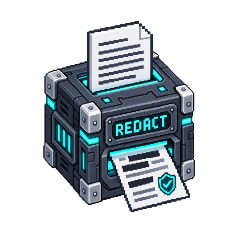

# Redact

Apply explicit minimization rules to text or JSON before downstream display or
export. This is not universal personal-data detection, anonymization certification,
binary/PDF redaction, or an authorization check.

<!-- block-metadata:start -->

Verified BloxSmith versions: **1.0.9** (bundled-block tests; see [test evidence](compatibility.json)).
<!-- block-metadata:end -->

## Ports and scope

Input `content` is required text. Select `text` or strict `json` explicitly in
configuration; content never supplies a policy or executable expression.

- `redacted`: complete transformed text or JSON text.
- `report`: action, format, per-category replacement counts, total, change flag
  and explicit `coverage: configured_rules_only`. No original values are copied.

Only this block's outputs are minimized. It **does not erase the upstream source,
runtime input snapshots, old logs, previous results, files or framework history**.
Avoid collecting or persisting sensitive data upstream when that is a requirement.
Values deliberately left outside the configured rules remain in the output.

## Rules and actions

JSON field names match exactly, case-insensitively, at every object depth.
Defaults target password, token, authorization, api_key and secret. A selected
field's whole value is replaced; its nested contents are not separately counted.
Other values keep their JSON type, except strings processed by the text rules.
Property names themselves are preserved, not scanned for embedded private data.

Optional email matching recognizes a bounded ASCII address pattern. It is not a
complete email parser and does not detect internationalized addresses, names,
phone numbers, images or obfuscated identifiers. Add up to 32 **literal** text
rules (1–128 characters); regex code is not accepted. Do not paste credentials
into literal configuration: target their JSON field instead.

Overlapping text matches use the earliest start and longest span; inserted
markers are not scanned again. Equal email/literal matches count as one email.
Matching is case-sensitive for literals and preserves all unmatched text.

- `mask`: replace selected values/matches with the literal marker, default
  `[REDACTED]`. Selected non-string JSON values intentionally become strings.
- `remove`: omit selected JSON object properties; remove matched spans within
  other strings. Array positions and non-selected properties remain intact.
  Removing text can join adjacent characters; downstream formatting is separate.
- `pseudonymize`: HMAC-SHA256 of canonical JSON value with a domain prefix,
  truncated to 128-bit hex and wrapped in `[redacted:…]`. Equal values under the
  same key produce equal tokens, including across Runs; different keys unlink
  those tokens. Type is part of canonical encoding.

Pseudonyms preserve equality information; they are not irreversible anonymization
against every threat model. The key is resolved through the public wallet API
from `secret_ref` (16–4,096 UTF-8 bytes). No plaintext key, lookup table or reverse
mapping is stored by this block. Missing/locked wallet fails without a fallback.
If the transformed output would contain the resolved key, publication is refused.
Key rotation deliberately changes tokens.

## Limits and failures

Default input limit: 1 MiB (configurable to 2 MiB). JSON has at most 50,000 nodes and
24 nested levels; duplicate properties and non-finite numbers are refused.
Default replacement limit: 10,000 (maximum 50,000); candidate-overlap work is capped
at four times that limit. Output expansion is capped at four times input policy.
Limit violations/cancellation emit no original or partial transformed content.

Cancellation is checked between nodes, patterns and matches. This small local
processor does not provide a hard preemptive deadline inside a single Python
string/regular-expression operation. Patterns are fixed or escaped literal scans,
not user-supplied regex programs. There is no filesystem/network access, native
decoder, external model or subprocess.

A zero-replacement report means only that configured rules found no match, not
that the document contains no sensitive data. A replacement can equal the input
marker; then counts are nonzero while `changed` is false.

## UI and verification

English/French modal and inspector share configuration and local drafts until
Apply. JSON-only fields, the fixed marker and wallet reference appear only when
relevant. The node card shows format/action, never content. Release-owned assets
do not change framework surfaces.

Owned tests exercise literal overlaps, nested JSON, removal, deterministic keyed
tokens, limits, cancellation, content-free errors, isolated wallet locking, both
runtimes and all package origins. Browser tests verify conditional controls,
keyboard access, saved settings and narrow layouts. No real wallet or provider
is used.
